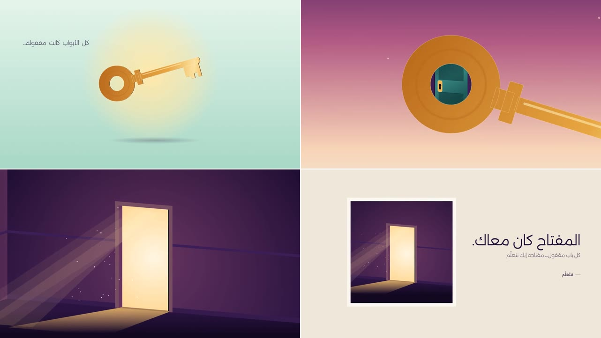

# fake3d: ستايل الثلاثي الأبعاد المزيّف

فكرة قصيرة عن العلم، في لقطة واحدة بلا قطع، بطلها مفتاح ذهبي ينتقل بين المشاهد:
1. **البناء:** لمعة صغيرة، ثم خط ذهبي يرسم المفتاح، ثم يمتلئ وجهه، ثم يظهر سُمكه وهو يلف أمامنا، مع جملة «كل الأبواب كانت مقفولة…».
2. **الرمية:** ينطلق المفتاح لأعلى وهو يدور، والكاميرا تصعد معه من نهار نعناعي إلى غروب ثم ليل بنجوم.
3. **العبور:** الكاميرا تدخل من فتحة حلقة المفتاح، فيظهر خلفها ممر مظلم وباب.
4. **القفل:** المفتاح يطير إلى الكالون، يدخل ويلف بتكّة، ونور يتسرب من تحت الباب.
5. **النور:** الباب ينفتح على ضوء دافئ بأشعة وذرات في الهواء، والكاميرا تدخل النور.
6. **البوستر:** تخرج الكاميرا من النور وترجع للوراء، فيتضح أن كل ذلك بوستر على حائط، بعنوان «المفتاح كان معاك.».

**ما يميّزه:**
- **ثلاثي أبعاد بلا محرّك 3D:**
  - كل جسم شكل مسطّح واحد، تُرصّ منه نسخ متتالية خلفه بلون أغمق فيظهر له سُمك حقيقي وهو يلف.
  - الإضاءة على الوجه تتغير مع الدوران، ولمعة تتحرك عليه.
- **لقطة واحدة بلا قطع:** الانتقال بين المشاهد يتم بحركة الشيء نفسه وبالكاميرا:
  - الصعود معه، ثم العبور من فتحة فيه.
  - الدخول في النور، ثم الرجوع للوراء لكشف البوستر.
- **مشهد بزاوية:** الممر والباب مرسومان بزاوية جانبية من أعلى، فيظهر عمق الحائط والحلق والأرضية.
- **إضاءة ناعمة:** توهج خلف المفتاح، وضوء يتسرب من تحت الباب، وأشعة وذرات في الهواء، وحبيبات خفيفة فوق الصورة كلها.
- **الألوان:**

  | | |
  |---|---|
  | البداية | نعناعي فاتح، من `#E6F5EC` إلى `#A6D7C5` |
  | السماء | غروب `#F8D3B6` و`#B25A82`، ثم ليل `#3B1859` و`#160A28` |
  | المفتاح | ذهبي، من `#FFF1BC` إلى `#F5B54A` إلى `#B4641A` |
  | الممر | بنفسجي غامق `#2A1441` |
  | الباب | فيروزي `#21625F` |
  | النور | `#FFF6E2` و`#FFC76A` |
  | الحائط الأخير | كريمي `#EFE7DA` |

- **الخط:** Alexandria بأوزان خفيفة (200 و300) للنصوص الصغيرة والعنوان.
- **الصوت:**
  - لمعة معدن، وبريق، ووشوشة الرمية، وهبّة العبور، والمفتاح وهو يدخل الكالون، وتكّة القفل، والباب وهو ينفتح.
  - كلها مولّدة بالكود، بلا موسيقى.

**المصدر:**
- صنعته قناة «مُتَعَلِّم» بـ Remotion بالكلام مع Claude Code.
- الأسلوب مستوحى من تقنية «fake 3D» في موشن جرافيك، بفكرة وألوان مختلفة.
- كل ما فيه مرسوم بالكود.

**لا يُنسخ منه:**
- القصة ونصوصها.
- يُؤخذ الأسلوب فقط.

## كيف بُني (للوكيل)

### الجسم المسطّح ذو السُمك
- **الإسقاط:** صورة شكل مسطّح في الفراغ، بإسقاط متوازي، هي مصفوفة `matrix()` واحدة.
  - محورا الشكل `u` و`v` بعد الدوران، ومركزه، تعطي معاملات المصفوفة الستة.
- **السُمك:**
  - تُرسم نفس الـ path عدة مرات، كل مرة بإزاحة صغيرة على اتجاه العمودي على الشكل، من الخلف للأمام.
  - عدد الطبقات بحسب طول السُمك على الشاشة (طبقة كل بكسل ونصف تقريبًا)، ولونها يتدرّج من الأغمق للأفتح.
  - الطبقة الأخيرة هي الوجه الظاهر: تدرّج ذهبي ولمعة يتحرك مكانها مع الدوران، أو الظهر بلون ثابت إذا كان الجسم مقلوبًا.
- **الإضاءة:** شدة لون الوجه من حاصل ضرب عمودي الوجه في اتجاه نور ثابت.
- **فتحة في الجسم** (مثل حلقة المفتاح): دائرة داخلية في نفس الـ path باتجاه رسم معاكس، فتظهر جدران الفتحة تلقائيًا.

### المشهد ذو الزاوية
- **الكاميرا:** لفّة أفقية (yaw) وميل (pitch) ثابتان، وزووم وهدف يتحركان بمفاتيح.
  - الحائط والأرضية والحلق مضلعات تُسقط نقطة نقطة.
  - الباب نفسه جسم مسطّح بسُمك، يلف حول مفصّلته.
- **ترتيب الرسم:** الحائط بفتحته يُرسم بعد الباب، فيغطي أي جزء من الباب دخل خلفه وهو ينفتح.
- **المفتاح في الكالون:** يُقصّ الجزء الداخل في الباب بقص في إحداثيات المفتاح نفسه، وحين ينفتح الباب يلف المفتاح معه حول المفصّلة.

### الانتقالات
- **من فتحة الحلقة:** زووم أُسّي حول مركز الفتحة، والمشهد التالي مرسوم كامل الشاشة ومقصوص بدائرة الفتحة، حتى تغطي الشاشة.
- **إلى البوستر:**
  - الكاميرا تدخل النور حتى يملأ الشاشة، ثم ومضة بنفس لون النور.
  - ثم يبدأ المشهد الأخير مكبّرًا على نقطة النور في البوستر، ويرجع للخلف.
  - البوستر نفسه هو نفس مشهد الباب، مرسوم داخل `<svg>` صغير بـ `viewBox`.
- **بناء المفتاح في البداية:** خط بـ `pathLength` و`strokeDasharray`، ثم شفافية الوجه، ثم السُمك من صفر لقيمته الكاملة.

| | |
|---|---|
| الملف | `reference.mp4` |
| الدقة | 1280×720، 30 إطارًا في الثانية |
| المدة | 0:18 |
| الصوت | مؤثرات فقط، بلا تعليق صوتي ولا موسيقى |

