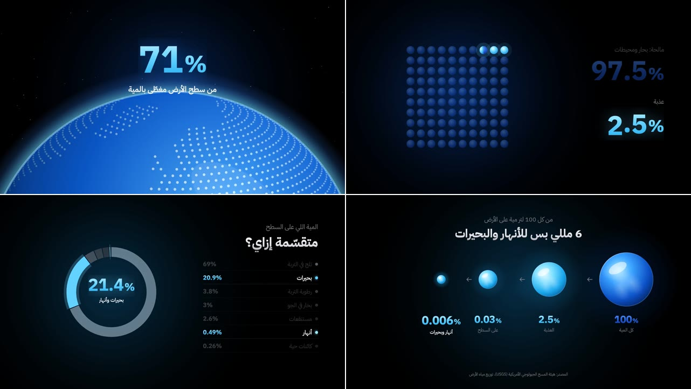

# infographic: ستايل الإنفوجرافيك بأسلوب عروض Apple

إحصائية حقيقية: «كم من مياه الأرض نستطيع أن نشربه؟»، تُروى بالأرقام والرسوم، وكل شكل يتحول إلى الشكل التالي بلا قطع:
1. **الأرض:**
   - كوكب يطلع من أسفل الكادر، بخريطة منقّطة وغلاف جوي يتوهج، ومعه «71%» من سطح الأرض مغطّى بالماء.
   - ثم ترجع الكاميرا فيظهر الكوكب كاملًا وهو يدور.
2. **كورة الماء:** قطرات تطير من الكوكب وتتجمع في كورة ماء لامعة، بينما تجف المحيطات وتنطفئ.
3. **١٠٠ نقطة:** الكورة تنفجر في مكانها إلى شبكة 10×10، فتصير 97.5 نقطة زرقاء غامقة (مالحة)، وتضيء 2.5 نقطة (عذبة).
4. **الشريط:**
   - النقاط العذبة تطير لتصير شريطًا واحدًا، ينقسم إلى جليد 68.7%، وماء جوفي 30.1%، وشريحة رفيعة 1.2% على السطح.
   - ثم زووم داخل الشريحة حتى تملأ الشريط.
5. **الحلقة:** الشريط ينثني فيصير حلقة كاملة تنقسم إلى أجزائها، وتضيء البحيرات والأنهار: «21.4%».
6. **الخلاصة:**
   - قطرة واحدة بجانب «0.006%»، و«لو الماء كله 100 لتر… الأنهار والبحيرات = 6 مللي».
   - ثم أربع كرات تصغر من 100% إلى 0.006%، مع المصدر.

**ما يميّزه:**
- **أسلوب عروض Apple:**
  - خلفية سوداء مع توهج ناعم يتحرك مع المشهد.
  - أرقام ضخمة بتدرّج ألوان وتوهج، وعناوين صغيرة رمادية فوقها.
- **أرقام كالعدّاد:** كل خانة عمود أرقام يدور، والخانات الأصغر تلف لفّات أكثر، فتبدو كعدّاد حقيقي.
- **انتقالات بالتحوّل:** كل رسم يصير الرسم التالي (كوكب ← كورة ← نقاط ← شريط ← حلقة ← قطرة ← كرات)، فلا قطع ولا شاشات منفصلة.
- **ظهور النص:** كل سطر يطلع من تحت قناع وهو يتوضح من ضبابية خفيفة، بإيزينج سريع البداية ناعم النهاية.
- **أرقام حقيقية بمصدرها:** من توزيع مياه الأرض الذي تنشره هيئة المسح الجيولوجي الأمريكية (USGS).
- **الأرقام إنجليزية** (0-9، والفاصلة نقطة، و% على اليمين)، والنصوص عربية.
- **الألوان:**

  | | |
  |---|---|
  | الخلفية | أسود `#000000`، وتوهج أزرق غامق `#0A3D91` |
  | المالح | أزرق غامق، من `#5B9BFF` إلى `#1239A0` |
  | العذب | سماوي، من `#C9F4FF` إلى `#64D2FF` إلى `#1AA7EC` |
  | الجليد | أبيض إلى `#8CCBFF` |
  | الجوفي | بنفسجي مزرق، من `#A8A6FF` إلى `#3D57E0` |
  | النصوص | أبيض `#F5F5F7`، ورمادي `#86868B` |

- **الخط:** IBM Plex Sans Arabic بأوزان 300 و500 و700.
- **الصوت:** هبّات ناعمة، ووشوشة الانتقالات، وتكّات العدّادات، وماء يصب، وقطرة. بلا موسيقى.

**المصدر:**
- صنعته قناة «مُتَعَلِّم» بـ Remotion بالكلام مع Claude Code.
- كل ما فيه مرسوم بالكود، والأرقام من USGS.

**لا يُنسخ منه:**
- الموضوع ونصوصه.
- يُؤخذ الأسلوب فقط.

## كيف بُني (للوكيل)

### الأرقام
- **العدّاد:** مكوّن يأخذ الرقم نصًا (مثل `97.5`)، ولكل خانة عمود أرقام 0-9 مكرر، يتحرك رأسيًا بقيمة تقدم بإيزينج.
  - الخانة الأصغر تلف `10 × ترتيبها` زيادة، فتسبق الخانات الكبيرة في اللف.
  - التدرّج على كل خانة بـ `background-clip: text`، والعلامة % بحجم أصغر على اليمين.
- **ظهور النص:** حاوية `overflow: hidden`، والنص بداخلها يتحرك من 70% لأسفل إلى صفر، مع شفافية و`blur` يقل.

### الرسوم
- **الكوكب:**
  - القارات مضلعات بخطوط طول وعرض تقريبية، تتحول مرة واحدة إلى شبكة نقاط على اليابسة.
  - كل نقطة تُسقط إسقاطًا كرويًا (orthographic) مع دوران وميل، فلا يظهر إلا ما على الوجه الأمامي.
  - حجم النقطة وإضاءتها حسب عمقها، وفوق ذلك ظل الليل وتوهج الغلاف الجوي.
- **الكورة:** دوائر بتدرّجات شعاعية: جسم، وانعكاسات ناعمة تدور داخلها، ولمعة، وحافة نور.
- **النقاط:** كل نقطة تبدأ عشوائيًا داخل الكورة، وتنتقل لمكانها في الشبكة بتأخير قطري.
- **الزووم داخل الشريحة:** نطاق الشريط من `[0, 100]` إلى `[0, 1.2]` بتحريك لوغاريتمي، وكل جزء يُعاد حساب مكانه، فلا يحدث تمدد في الحواف المستديرة.
- **الشريط يصير حلقة:** قوس طوله ثابت (طول الشريط) ونصف قطره يقل من قيمة كبيرة جدًا حتى محيط الحلقة. انحناؤه يتحرك لوغاريتميًا، فيبدو كأنه ينثني.
- **الحلقة:** كل جزء دائرة بـ `strokeDasharray` و`strokeDashoffset` تراكمي، والأجزاء المميزة لها توهج بخط أعرض وأشف خلفها.

| | |
|---|---|
| الملف | `reference.mp4` |
| الدقة | 1280×720، 30 إطارًا في الثانية |
| المدة | 0:28 |
| الصوت | مؤثرات فقط، بلا تعليق صوتي ولا موسيقى |

