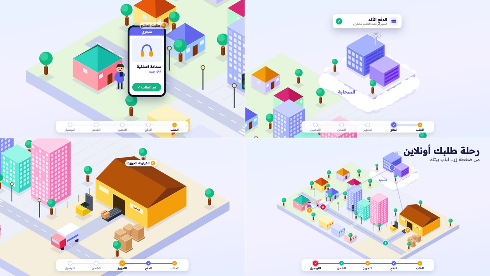

# isometric: ستايل العالم الأيزومتريك

شرح «رحلة طلبك أونلاين» في عالم أيزومتريك كبير بأربع مناطق، والكاميرا تسافر بينها مع الطلب:
1. **الحي السكني:** شخص أمام بيته يطلب سماعة من هاتفه.
2. **السحابة:** جزيرة طائرة فوق السحاب عليها السيرفرات، يصل إليها الطلب فيتأكد الدفع.
3. **المنطقة الصناعية:** مخزن يُفتح بابه، وكرتونة تخرج على سير وتُغلَّف، ثم تقفز فوق العربية.
4. **المدينة:** العربية تمر بين الأبراج والمحلات، وتقف عند الإشارة الحمراء.
5. **البيت:** الكرتونة تقفز إلى صاحبها، ثم تبتعد الكاميرا لتُظهر العالم كله ومسار الرحلة مرقّمًا.

**ما يميّزه:**
- **عالم واحد كبير:**
  - أرض لها سُمك، مقسومة إلى مناطق بألوان مختلفة، يمر بينها طريق رئيسي بخطوط بيضاء وممر مشاة.
  - كل مبنى صندوق بثلاثة أوجه من درجات لون واحد، عليها نوافذ وأبواب ولافتات، وتحته ظل ناعم.
- **تفاصيل حية:**
  - إشارة مرور تتغير، وأشجار تتمايل، ودخان يخرج من العربية.
  - أضواء السيرفرات تومض أسرع وهي تعالج الطلب، وموجات تخرج من الهوائي.
- **الكاميرا:**
  - تنتقل بين المناطق بحركة ناعمة، وتتبع العربية في الطريق.
  - في النهاية تبتعد لتُظهر العالم كاملًا.
- **البيانات:** الطلب يطير من الهاتف إلى السحابة، ثم إلى المخزن، نقاطًا مضيئة على قوس منقّط.
- **واجهات فوق العالم:**
  - هاتف المتجر بزر «اطلب الآن» ونقرة عليه، وبطاقة «الدفع اتأكد».
  - تاجات مرقّمة بجانب كل مرحلة.
  - شريط مراحل في الأسفل يمتلئ: الطلب، والدفع، والتجهيز، والشحن، والتوصيل.
- **الألوان:**

  | | |
  |---|---|
  | الخلفية | لافندر فاتح، من `#EAF1FF` إلى `#F4F1FF` |
  | الحي السكني | أخضر فاتح `#E4F5DC` |
  | المدينة | رمادي مزرق `#EEF0F8` |
  | المنطقة الصناعية | رملي `#F6EEDC` |
  | النصوص | `#1E1B4B` |
  | ألوان المراحل | بنفسجي `#6366F1`، وكهرماني `#F59E0B`، وفيروزي `#14B8A6`، ووردي `#E11D48` |

- **الخط:** Readex Pro بأوزان 400 و500 و700.
- **الصوت:**
  - نقرة الزر، وصوت البيانات وهي تطير، وفتح الباب، وطنين السير، وموتور العربية، وارتطام الكرتونة، ولمعة عند الوصول.
  - بلا موسيقى.

**المصدر:**
- صنعته قناة «مُتَعَلِّم» بـ Remotion بالكلام مع Claude Code.
- كل ما فيه مرسوم بالكود.

**لا يُنسخ منه:**
- الموضوع ونصوصه.
- يُؤخذ الأسلوب فقط.

## كيف بُني (للوكيل)

### الإسقاط
- **دالة واحدة** تحوّل أي نقطة في العالم `(x, y, z)` إلى الشاشة:
  - `X = OX + (x − y) · cos30° · S`
  - `Y = OY + (x + y) · 0.5 · S − z · S`
  - و`S` طول الوحدة بالبكسل.
- **الصندوق:**
  - ثلاثة مضلعات: الأعلى، والوجه الأيسر، والوجه الأيمن، بثلاث درجات من لون واحد.
  - وخط أبيض شفاف على الحواف العلوية.
- **الرسم على الأوجه:** مصفوفة `matrix()` تلصق مستطيلًا عاديًا على وجه الصندوق، فتُرسم النوافذ والأبواب واللافتات بإحداثيات مسطحة.
- **ترتيب العمق:**
  - لكل عنصر على الأرض مفتاح `x + y`، وتُرسم العناصر من الأصغر إلى الأكبر.
  - اتجاه النظر هو `(1, 1, 1)`، فالشيء المرتفع (الجزيرة الطائرة، أو الكرتونة وهي فوق العربية) يُرسم بعد ما تحته.

### الحركة
- **العربية:** دالة في الزمن تمر بمراحل:
  1. تنتظر عند الطريق.
  2. ترجع إلى السير.
  3. تخرج إلى الطريق الرئيسي.
  4. تقف عند الإشارة الحمراء.
  5. تكمل إلى البيت.
  - تغيّر اتجاهها عند الدوران فجأة، وتخفي ذلك نطّة صغيرة وانضغاط.
- **الكرتونة** تنتقل بين أكثر من مكان:
  - على السير، ثم قفزة بقوس إلى سقف العربية.
  - فوق السقف ترسمها العربية نفسها، فتتحرك معها.
  - ثم قفزة أخيرة إلى صاحبها.
- **الكاميرا:**
  - مفاتيح بنقاط من العالم `[زمن، x، y، z، زووم]`، لا بإحداثيات الشاشة.
  - وفوقها وضع «تتبّع» يمتزج تدريجيًا مع مكان العربية.

### النصوص والتكوين
- **النصوص العربية** كلها في طبقة HTML فوق الـSVG، ومكانها يُحسب بإسقاط نقطة من العالم إلى الشاشة.
  - لا تكتب نصًا عربيًا في SVG بـ `textAnchor="end"` مع `direction="rtl"`: يخرج النص عن مكانه.
- **التكوين:** لا تضع مبنى عاليًا أمام مكان تقف فيه شخصية أو تمر فيه العربية، فكل ما هو أقرب للمشاهد وأعلى يغطي ما خلفه.

| | |
|---|---|
| الملف | `reference.mp4` |
| الدقة | 1280×720، 30 إطارًا في الثانية |
| المدة | 0:28 |
| الصوت | مؤثرات فقط، بلا تعليق صوتي ولا موسيقى |

