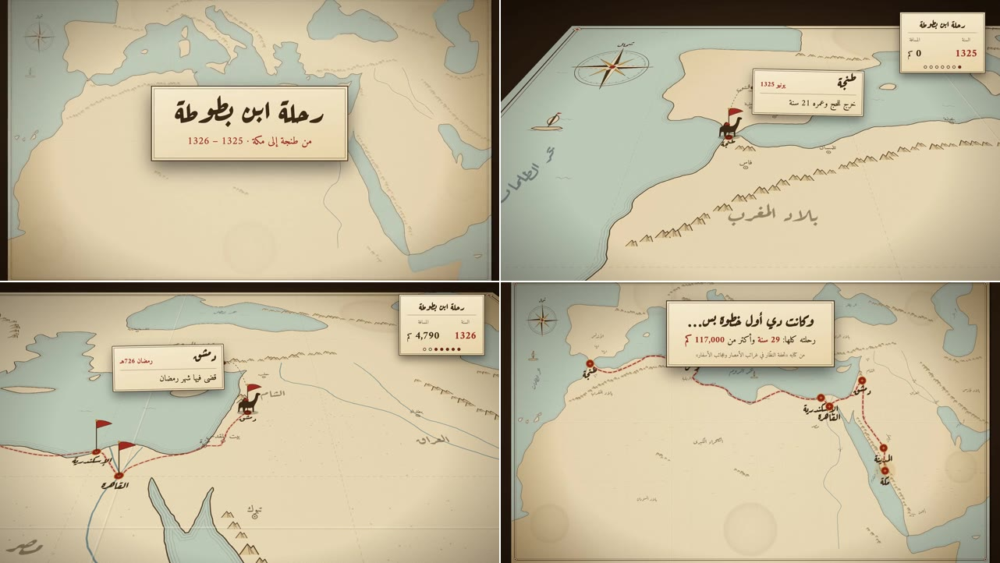

# map-journey: ستايل رحلة الخريطة

«رحلة ابن بطوطة: من طنجة إلى مكة (1325–1326)» على خريطة قديمة، والكاميرا تطير فوقها بزاوية سينمائية:
1. **الافتتاح:**
   - خريطة على مكتب خشبي تُرسم سواحلها بالحبر أمامنا، مع لوحة العنوان «رحلة ابن بطوطة».
   - ثم تنزل الكاميرا عبر السحاب وتميل لزاوية ثلاثية الأبعاد فوق طنجة.
2. **الرحلة:**
   - جمل واقف على الخريطة يمشي على خط أحمر يُرسم بالحبر، وخلفه غبار خفيف.
   - تمر الرحلة بسبع محطات: طنجة، وتونس، والإسكندرية، والقاهرة، ودمشق، والمدينة، ومكة.
3. **عند كل محطة:**
   - علم يطلع من الخريطة بصوت ختم، واسم المدينة يُكتب عليها.
   - كارت ورقي متصل بالعلم فيه المدينة والتاريخ ومعلومة من رحلته، مثل «خرج للحج وعمره 21 سنة» و«شاف منارة الإسكندرية».
4. **الخاتمة:**
   - ترجع الكاميرا للخريطة كلها والطريق كامل عليها.
   - «وكانت دي أول خطوة بس… رحلته كلها 29 سنة وأكتر من 117,000 كم».

**ما يميّزه:**
- **خريطة حقيقية بروح قديمة:**
  - سواحل البحر المتوسط وشمال أفريقيا والبحر الأحمر والجزيرة العربية والخليج بخطوط طول وعرض تقريبية.
  - بأسماء تاريخية: «بحر الظلمات»، و«بحر الروم»، و«بحر القلزم»، و«إفريقية»، و«الشام».
- **تفاصيل بالحبر:**
  - خطوط ماء موازية للسواحل، وجبال على السلاسل الحقيقية، ورمل وكثبان في الصحارى، وأنهار.
  - بوصلة، ومراكب، وخطوط الطول والعرض، وإطار مزدوج، وطيّات الورق.
- **كاميرا سينمائية:** الخريطة مستوى مائل بمنظور ثلاثي الأبعاد، والكاميرا تتبع القافلة، وتقترب عند المحطات، وتبتعد في الطرق الطويلة.
- **أشياء واقفة على الخريطة:** الجمل والأعلام مرسومة فوق الصورة في مكانها الصحيح على المستوى المائل، فتبدو واقفة عليه.
- **لوحة جانبية:** السنة، والمسافة الحقيقية المقطوعة (تُحسب من خطوط الطول والعرض)، ونقطة لكل محطة.
- **الألوان:**

  | | |
  |---|---|
  | الورق | `#EAD9B5` إلى `#C9AA72` عند الحواف |
  | البحر | أخضر مزرق باهت `#BFCDBE` |
  | الحبر | بني غامق `#3B2716` |
  | خط الرحلة | أحمر طوب `#9C2A1C` |
  | الذهبي | `#B8862B` |
  | المكتب | خشب غامق `#24170E` |

- **الخطوط:** Aref Ruqaa للعناوين وأسماء المدن والبحار، وAmiri للنصوص والأرقام.
- **الصوت:**
  - ريح خفيفة طول الوقت، وخربشة قلم وهو يرسم الخريطة، وهبّة مع نزول الكاميرا.
  - خطوات القافلة، وختم مع كل علم، وصوت ورق مع كل كارت. بلا موسيقى.

**المصدر:**
- صنعته قناة «مُتَعَلِّم» بـ Remotion بالكلام مع Claude Code.
- كل ما فيه مرسوم بالكود.
- المعلومات من كتاب ابن بطوطة «تحفة النظّار في غرائب الأمصار وعجائب الأسفار».

**لا يُنسخ منه:**
- القصة ونصوصها.
- يُؤخذ الأسلوب فقط.

## كيف بُني (للوكيل)

### الخريطة
- **الإسقاط:** `x = (lon + 18) × K × cos(30°)` و`y = (47 − lat) × K`، أي إسقاط مستطيل بسيط مضغوط أفقيًا.
- **البحار:**
  - مضلعات (خط طول، خط عرض) مرسومة فوق أرضية الورق.
  - الحواف الصناعية للمضلع بعيدة خارج حدود الورقة، فتنقصّ ولا تظهر.
- **خط الحبر:** المضلعات تمر بـ Catmull-Rom لتنعم، مع رعشة صغيرة ثابتة كخط اليد، ثم تُرسم بـ `pathLength` و`strokeDasharray` في الافتتاح.
- **خطوط الماء على السواحل:**
  - حد البحر نفسه يُرسم ثلاث مرات بعرض كبير ثم أصغر، كل مرة بالحبر ثم بلون البحر فوقه.
  - كل ذلك مقصوص داخل البحر، فتظهر ثلاث خطوط موازية للساحل.
- **الرمل:** نقاط عشوائية في مستطيلات الصحارى، ويُستبعد أي نقطة داخل البحر باختبار نقطة داخل مضلع.

### الكاميرا والمنظور
- **الميل:** الـ SVG كله داخل `div` بـ `perspective(1400px) rotateX(θ)` من CSS، والزووم والتحريك داخل الـ SVG نفسه، فيبقى الرسم حادًا.
- **الأشياء الواقفة:** مكانها على الشاشة يُحسب بنفس الإسقاط:
  - `Y' = Y·cosθ` و`z = Y·sinθ`.
  - والمقياس `P / (P − z)`.
  - ثم تُرسم فوق الصورة بحجم يتغير بالمقياس.
- **متابعة القافلة:** مركز الكاميرا بين القافلة ونقطة أمامها على الطريق، والزووم يقل في منتصف كل مرحلة طويلة ويزيد عند الوصول.

### الطريق
- **المنحنى:** نقاط الطريق تمر بـ Catmull-Rom وتتحول لعيّنات بطول تراكمي.
- **الرسم:** مكان الرأس وجزء الطريق المرسوم يُحسبان من الطول في كل إطار.
- **المحطات:** لكل محطة وقت وصول ووقت مغادرة، وبينهما الرأس واقف.
- **عدّاد المسافة:** مسافة حقيقية بمعادلة هافرساين بين نقاط الطريق، تتوزع على طول المنحنى.

| | |
|---|---|
| الملف | `reference.mp4` |
| الدقة | 1280×720، 30 إطارًا في الثانية |
| المدة | 0:34 |
| الصوت | مؤثرات فقط، بلا تعليق صوتي ولا موسيقى |

