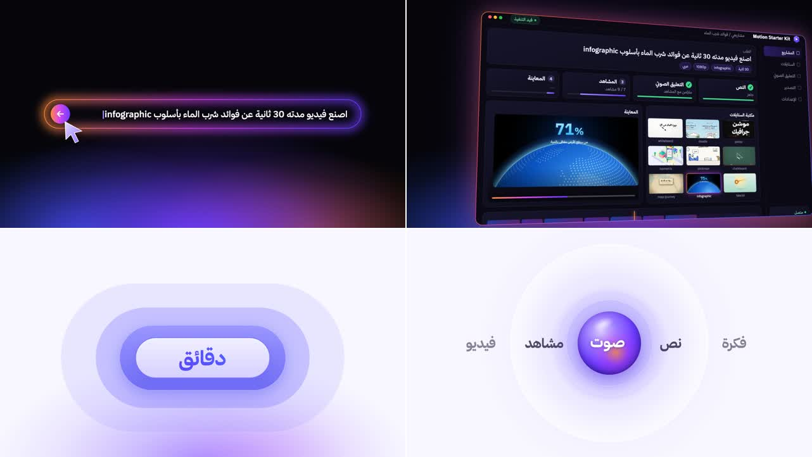

# product: ستايل برومو إطلاق منتج

إعلان قصير لمنتج تقني بأسلوب شركات البرمجيات. المنتج في العينة هو الريبو نفسه: «Motion Starter Kit».
1. **كلمات ضخمة:**
   - «اصنع» تملأ الشاشة، ثم تصغر لتصير سطرًا: «اصنع فيديو موشن».
   - ثم «بالكلام فقط».
2. **خانة الطلب:**
   - إطار نيون يرسمه ضوء يجري حوله، والكاميرا قريبة من أول السطر.
   - يُكتب فيه طلب: «اصنع فيديو مدته 30 ثانية عن فوائد شرب الماء بأسلوب infographic».
   - ترجع الكاميرا مع الكتابة، ثم يأتي الماوس ويضغط زر الإرسال، فيتوهج المكان.
3. **اللوجو:** الأيقونة تظهر، والاسم ينفتح من خلفها بضربة صوت.
4. **واجهة البرنامج في ثلاثي الأبعاد:**
   - نافذة مائلة بحافة متوهجة، والكاميرا تتحرك حولها.
   - في الداخل تكتمل المراحل واحدة بعد الأخرى: النص، والتعليق الصوتي، والمشاهد، والمعاينة.
   - ثم يُختار الستايل من المكتبة، ويعمل الفيديو في المعاينة.
5. **جزء فاتح:**
   - «وقت صناعة الفيديو»، وكبسولة تتبدل فيها الكلمات: أيام ← ساعات ← دقائق.
   - مع كل خطوة تكبر حولها حلقات أكثر.
6. **«لكل فكرة أسلوبها»:** ثم كروت الستايلات تطير في الفراغ، والكاميرا تتقدم بينها.
7. **كورة زجاج:**
   - الخطوات تمر عليها: فكرة ← نص ← صوت ← مشاهد ← فيديو، وكل كلمة تصير بيضاء وهي فوق الكورة.
   - بعدها قائمة المميزات.
8. **كلمات سريعة:** «مجاني ومفتوح المصدر»، ثم «بسيط» ← «وقوي».
9. **النهاية:**
   - كور زجاج تدور حول الأيقونة، ثم تنضم إليها.
   - ثم الاسم ورابط الريبو.

**ما يميّزه:**
- **كلمات حركية:** الكلمة الأولى تدخل ضخمة من ضبابية، ثم تصغر، والكلمات التالية تدخل بجانبها واحدة بعد الأخرى.
- **توهج الخلفية:** بقع ناعمة بنفسجية وزرقاء وبرتقالية تتحرك ببطء أسفل الكادر. تصير أدفأ لحظة الضغط على الإرسال.
- **واجهة حقيقية:** نافذة البرنامج مبنية بالكود كواجهة كاملة (قائمة جانبية، ومراحل بشرائط تقدم، ومكتبة، ومعاينة، وخط زمني). كل ما فيها يتحرك بالوقت.
- **عمق ثلاثي الأبعاد:** النافذة والكروت مائلة بمنظور حقيقي، والكاميرا تتحرك بينها.
- **تبديل بين الظلام والنور:** أجزاء سوداء وأجزاء بيضاء، بقطع حاد في اللحظة المناسبة.
- **الألوان:**

  | | |
  |---|---|
  | الخلفية | أسود `#05050A`، والجزء الفاتح `#F8F7FF` |
  | البنفسجي | من `#A88BFF` إلى `#6C3BFF` |
  | الأزرق | `#2F5BFF` |
  | الوردي | `#D946EF` |
  | البرتقالي | `#FF6A1A` إلى `#FF8A3D` |
  | النصوص | أبيض `#F5F3FF`، ورمادي `#8B88A6` |

- **الخط:** «ثمانية» (Thmanyah Sans) بأوزان 300 و400 و500 و700.
- **الصوت:**
  - مؤثرات حقيقية: هبّات مع الكلمات والانتقالات، ومسح ضوئي مع الإطار، وضغطات كيبورد، وكليك ماوس.
  - صعود ثم ضربة سينمائية للوجو والنهاية، وشفطة مقلوبة عند القطع من الظلام إلى النور.
  - بلا موسيقى.

**المصدر:**
- صنعته قناة «مُتَعَلِّم» بـ Remotion بالكلام مع Claude Code.
- كل ما فيه مرسوم بالكود. صور الستايلات من معاينات الريبو نفسه.

**لا يُنسخ منه:**
- الاسم والنصوص.
- يُؤخذ الأسلوب فقط.

## كيف بُني (للوكيل)

### النصوص
- **سطر الكلمات:**
  - الكلمة الأولى تدخل بشفافية و`blur` يقل وتصغير خفيف.
  - ثم يتحرك حجم الخط من الكبير إلى الصغير، والكلمات التالية تدخل بتأخير متدرج.
  - الخروج بـ `blur` وإزاحة جانبية.
- **النص المتدرج:**
  - `background-clip: text` مع حشوة وهامش سالب بنفس القيمة.
  - الحشوة تكبّر صندوق الخلفية فلا تُقص نقاط الياء والحروف النازلة.

### الخلفية والإطار
- **التوهج:** كل بقعة `radial-gradient(closest-side, …)` تصل للشفافية عند حافة صندوقها بالضبط، فلا تظهر لها حواف.
- **خانة الطلب:**
  - مستطيل SVG بـ `pathLength={1}` و`strokeDasharray` للرسم، وشرطة بيضاء قصيرة تمشي أمامه كرأس الضوء.
  - نسخة من الحافة بعرض أكبر وتمويه للتوهج.
  - الزووم بـ `transform-origin` عند أول السطر، ويرجع للخلف مع الكتابة.
- **اللوجو:** الاسم داخل حاوية `maxWidth` تكبر مع `overflow: hidden`، فيدفع الأيقونة جانبًا وهو ينفتح.

### العمق
- **النافذة:**
  - CSS `perspective` مع `rotateX` و`rotateY` و`translateZ`.
  - مفاتيح كاميرا تُدمج بإيزينج ناعم.
  - خلف النافذة طبقة بتدرج ألوان وظلال متوهجة، فتبدو الحافة نيونًا.
- **الكروت:**
  - كل كارت له `translateZ` ثابت، والكاميرا تتقدم بقيمة واحدة تُضاف للكل.
  - الكارت يختفي وهو يعبر بجانب الكاميرا.
  - صوت العبور يُحسب من نفس المعادلة (عكس الإيزينج)، فيأتي في لحظة العبور.

### الكورة
- **الكلمات البيضاء فوق الكورة:**
  - صف الكلمات يُرسم مرتين: نسخة غامقة، ونسخة بيضاء مقصوصة بـ `clip-path: circle()` على مكان الكورة.
  - فتصير الكلمة بيضاء داخل الكورة فقط، حتى لو كان نصفها داخلها.
- **الحلقات:** كبسولات بنفس المركز، يكبر عرضها وارتفاعها مع كل خطوة.
- **الكبسولة:** الكلمات تتدحرج رأسيًا داخل كبسولة `overflow: hidden`.

### الصوت
- لكل ملف صوت وقت قمته بداخله (جدول `PEAK`).
- يبدأ الصوت قبل الحدث بنفس المقدار، فتقع القمة على اللحظة بالضبط.
- والصعود يُضبط على لحظة نهايته.

| | |
|---|---|
| الملف | `reference.mp4` |
| الدقة | 1280×720، 30 إطارًا في الثانية |
| المدة | 0:40 |
| الصوت | مؤثرات فقط، بلا تعليق صوتي ولا موسيقى |

