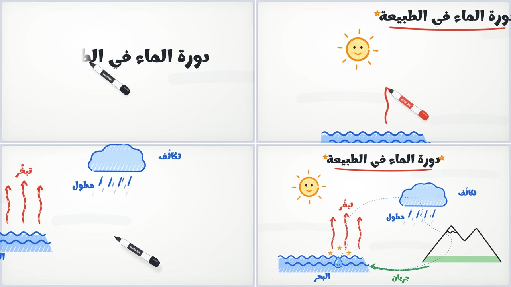

# whiteboard: ستايل السبورة البيضاء

درس قصير عن «دورة الماء في الطبيعة»: ماركر يرسم على سبورة بيضاء أمامك خطوة بخطوة، والكاميرا تقترب من كل جزء وهو يُرسم، ثم تبتعد لتُظهر الصورة كاملة.

**ما يميّزه:**
- **الماركر وحده يرسم، بلا يد:**
  - يرتفع قليلًا ويبتعد ظله حين ينتقل بين الرسومات.
  - ولونه يتغير مع لون الخط الذي يرسمه.
- **الخط:** ماركر حقيقي يزيد سمكه ويقل، ويبدأ وينتهي بهدوء لا بسرعة ثابتة.
- **الكلام:** يُكتب من اليمين إلى اليسار بحافة ناعمة، والماركر يتبع الكتابة. وحين تكتمل الكلمة تهتز هزة خفيفة.
- **التلوين:** تهشير مائل ذهابًا وإيابًا بالماركر، داخل حدود كل شكل.
- **الكاميرا:** تقترب من كل جزء وهو يُرسم، ثم تبتعد في النهاية لتُظهر الصورة كاملة.
- **الرسمة تعيش بعد اكتمالها:** الشمس لها وجه وتدور ببطء، والبخار يصعد، والمطر ينزل، والنهر يجري. وفي النهاية تدور قطرة ماء بوجه حول الدورة كلها.
- **الإيقاع هادئ:** ٢٣ ثانية لرسمة واحدة.
- **الألوان:**

  | | |
  |---|---|
  | الحبر | `#23272E` |
  | الأزرق | `#1E63D6` |
  | الأحمر | `#E0412E` |
  | البرتقالي | `#F28C12` |
  | الأخضر | `#2E9B4F` |
  | السبورة | بيضاء مائلة إلى الرمادي، وعليها آثار مسح خفيفة |

- **الخط:** Marhey بوزن 700.
- **الصوت:**
  - خربشة ماركر مع كل خط.
  - نقرة مع كل كلمة.
  - صوت غطاء الماركر في النهاية.
  - بلا موسيقى.

**المصدر:**
- صنعته قناة «مُتَعَلِّم» بـ Remotion بالكلام مع Claude Code.
- كل ما فيه مرسوم بالكود: لا صور، ولا فيديو مولَّد.

**لا يُنسخ منه:**
- الموضوع ونصوصه.
- يُؤخذ الأسلوب فقط.

## كيف بُني (للوكيل)

### الرسم
- **الخط المرسوم تدريجيًا:**
  - خذ نقاطًا على المسار بـ `getPointAtLength` من `@remotion/paths`.
  - في كل إطار، مرّر النقاط حتى نسبة التقدم إلى `getStroke` من [perfect-freehand](https://github.com/steveruizok/perfect-freehand) مع `simulatePressure`.
  - ارسم الناتج شكلًا مملوءًا بلون الماركر.
- **التهشير:**
  - مسار زجزاج مائل يملأ مربعًا حول الشكل، ويُرسم بـ `strokeDasharray`.
  - يُقص بـ `clipPath` على حدود الشكل.
  - استخدم شفافية نحو 0.55 ليبدو كالماركر.
- **الكتابة العربية:**
  - النص يكون HTML لتتصل الحروف.
  - يظهر بـ `mask-image: linear-gradient(to left, …)`، وتتحرك حافته من اليمين إلى اليسار.

### الحركة
- **الكاميرا:**
  - مفاتيح زمنية (x وy وzoom) بـ `Easing.inOut(Easing.cubic)`.
  - طبّق نفس التحويل على طبقة SVG وطبقة HTML حتى يتحركا معًا.
- **الإيقاع:**
  - التوقيتات مكتوبة بوحدة «خطوة» مضروبة في معامل بطء واحد (`TS`)، فيمكن تبطيء الفيديو كله بتغيير رقم واحد.
  - الحركات المستمرة (المطر والنهر والشمس) تعمل بالزمن الحقيقي، لا بالمعامل.

### الصوت
- صوت الماركر مُولَّد بالكود:
  - ضوضاء مفلترة بين 1.8 و7 كيلوهرتز.
  - تتغير شدتها بنبضات من 9 إلى 14 هرتز.
  - وتتخللها صرصرات قصيرة.

### تحذير
- `getPointAtLength` قد يرجع `null` عند آخر طول المسار بالضبط (بسبب دقة الأرقام).
- فقف قبله بقليل: `Math.min(L * k, L - 1e-4)`.

| | |
|---|---|
| الملف | `reference.mp4` |
| الدقة | 1280×720، 30 إطارًا في الثانية |
| المدة | 0:23 |
| الصوت | مؤثرات فقط (ماركر، ونقرات، وغطاء)، بلا تعليق صوتي ولا موسيقى |

